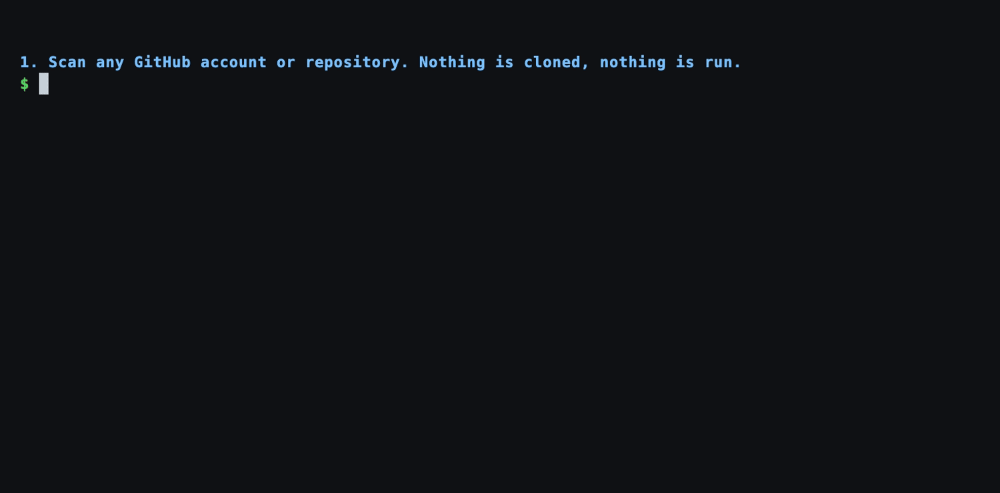
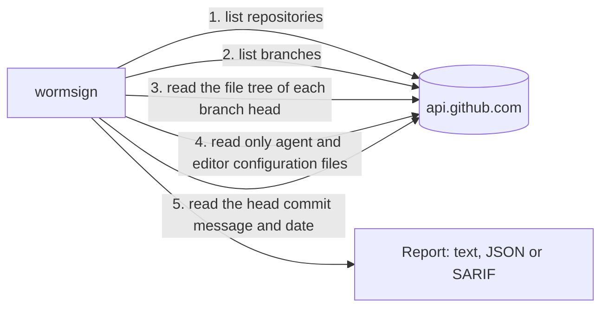

# wormsign

[](https://github.com/nukoe-labs/wormsign/actions/workflows/ci.yml)
[](https://www.npmjs.com/package/wormsign)


[](LICENSE)

**Find Shai-Hulud and Miasma worm infections in a GitHub account or organization, on every branch, through the
GitHub API only. Nothing is cloned, nothing is run.**

```sh
pnpm dlx github:nukoe-labs/wormsign <user | organization | owner/repo>
# or: npx github:nukoe-labs/wormsign <user | organization | owner/repo>
```



*Real recording, 20/11/2026, of a repository named in
[SafeDep's report on the Miasma worm](https://safedep.io/testmetest-npm-worm-miasma-variant/) (its owner was
notified). Exit code 1 means that worm signs were found.*

## Why

Since late 2025, the Shai-Hulud family of worms (Shai-Hulud 2.0, Mini Shai-Hulud, Miasma) steals a developer's
GitHub token, then pushes files into **all** of their repositories. Those files run as soon as someone opens the
folder with Claude Code, Cursor, Gemini CLI or VS Code: a `SessionStart` hook, a `folderOpen` task, a 3.7 MB
obfuscated `setup.js`. Every person who clones the repository and opens it becomes the next victim.

Victims clean the default branch and forget the others. Some are re-infected days later because the token was still
valid. `wormsign` answers the question every victim and every organization asks: **which of my repositories, on
which branches, carry the worm, and is it back?**

<!-- STUDY:START -->
<!-- STUDY:END -->

## Install and run

```sh
pnpm dlx github:nukoe-labs/wormsign my-org                               # no install, no configuration
GITHUB_TOKEN=$(gh auth token) pnpm dlx github:nukoe-labs/wormsign my-org # 5,000 requests per hour instead of 60
pnpm dlx github:nukoe-labs/wormsign owner/repo                           # check one repository BEFORE you clone it
pnpm dlx github:nukoe-labs/wormsign --path ./downloaded-project          # check a local folder BEFORE an agent or editor opens it
pnpm dlx github:nukoe-labs/wormsign my-org --json                        # for scripts
pnpm dlx github:nukoe-labs/wormsign my-org --sarif > wormsign.sarif      # for the GitHub Security tab
```

Without pnpm, `npx` works the same way: `npx github:nukoe-labs/wormsign my-org`.

The package is not on npm yet: these commands run the build committed in this repository (`dist/`).

| Exit code | Meaning |
|---|---|
| `0` | No worm sign. Notes to review (medium findings) may be printed. |
| `1` | At least one worm sign (critical or high finding). Follow [the guide](docs/if-you-are-hit.md). |
| `2` | The scan could not run (unknown owner, network, rate limit too far away). |

- **Every branch**: up to 20 branches per repository by default (`--max-branches <n>` or `--max-branches=<n>`), each commit read once.
- **Rate limits handled**: when GitHub asks to wait less than 5 minutes, wormsign waits and retries; otherwise it
  stops with the reset time and the fix. Large accounts are read page by page.
- **Zero dependencies**, Node.js 20 or later, colored output on a terminal (`NO_COLOR` is respected).

## How it works



wormsign only sends `GET` requests to `api.github.com`. It never writes to GitHub, never downloads a whole
repository, never writes to your disk (except the SARIF file you ask for), and sends no data anywhere else: there is
no telemetry and no server of ours. You can check it in [`src/github.ts`](src/github.ts), the only file that makes
network requests.

Words used below:

- **Hook**: a command that an AI coding agent runs by itself at a given moment, for example when a session starts.
- **`folderOpen` task**: a VS Code task (also in Cursor and Windsurf) that runs when the folder is opened.
- **MCP server**: a local program that an agent starts to get new tools (MCP means Model Context Protocol).
- **Exfiltration repository**: a repository created by the worm, under the victim's name, to publish stolen secrets.
- **Branch head**: the latest commit of a branch.

## Rules

Critical and high findings are **worm signs** (exit code 1). Medium findings are **notes**: they can match
legitimate projects and are printed so that a human reads the file.

| Rule | Severity | What it finds |
|---|---|---|
| WS001 | high | A hook that starts a worm payload (`setup.js`, `init.js`, or `curl ... \| sh`) as soon as an agent session starts, in `.claude/settings.json`, `.claude/settings.local.json`, `.gemini/settings.json` or `.cursor/hooks.json` |
| WS002 | high | A task in `.vscode/tasks.json` with `"runOn": "folderOpen"` that starts a worm payload (VS Code, Cursor, Windsurf) |
| WS003 | medium | A local MCP server command in `.mcp.json`, `.cursor/mcp.json`, `.vscode/mcp.json`, `.roo/mcp.json`, `.gemini/settings.json`, or an `mcp_servers.<name>.command` key of `.codex/config.toml`, however the TOML spells it |
| WS004 | high | A script of 500 KB or more in `.claude/`, `.cursor/`, `.gemini/`, `.vscode/`, or named `setup.js` / `init.js` / `init.ps1` at the root, in `scripts/` or in `.github/` |
| WS005 | high | Invisible or text-direction characters in `CLAUDE.md`, `AGENTS.md`, `GEMINI.md`, `.cursorrules`, Cursor rules or Copilot instructions |
| WS006 | medium | An instruction file that tells the agent to act "without asking", to "hide the output" or to "run setup first" |
| WS007 | critical | A branch head commit with a worm marker: `AutoSyncComplete:`, `msync-xxxx`, `DEVOPS-SEALED` |
| WS008 | critical | An exfiltration repository: description `Sha1-Hulud: The Second Coming.`, `Shai-Hulud: Here We Go Again`, or `project-utils` with a random name such as `smart-workers-48213`; or the name `s1ngularity-repository`, optionally followed by `-0`, `-1`... (Nx compromise) |
| WS009 | medium | A default branch whose head commit, next to an autorun finding, is dated 30 days or more before the last push |
| WS010 | medium | Any other agent hook that runs a command (formatters, linters, session checks) |
| WS011 | critical | An instruction file that carries a worm marker (`DEVOPS-SEALED`) |
| WS012 | medium | Any other `folderOpen` task (for example a watcher) |
| WS013 | medium | With `--path`: an agent configuration or instruction file larger than 1 MB, which is not read; padding must not make a folder look clean |

Every marker, with the public report it comes from, is in [`src/signatures.ts`](src/signatures.ts).

## Measured false positives

<!-- BENCHMARK:START -->
<!-- BENCHMARK:END -->

## GitHub Action

Scan your organization every day and get a failed run, a summary and optional Security tab alerts when a worm
appears. Available on the [GitHub Marketplace](https://github.com/marketplace/actions/wormsign-scan).

```yaml
name: wormsign
on:
  schedule:
    - cron: "17 6 * * *"
  workflow_dispatch:
permissions: {}
jobs:
  scan:
    runs-on: ubuntu-latest
    permissions:
      contents: read
      security-events: write # only for the SARIF upload
    steps:
      - uses: nukoe-labs/wormsign@v1 # or pin the commit SHA of a release
        with:
          target: ${{ github.repository_owner }}
          sarif: "true"
      - if: always()
        uses: github/codeql-action/upload-sarif@v4
        with:
          sarif_file: wormsign.sarif
```

| Input | Default | Meaning |
|---|---|---|
| `target` | the repository owner | A user, an organization, or `owner/repo` |
| `max-branches` | `20` | Branches read per repository |
| `fail-on-findings` | `true` | Fail the job when a worm sign is found |
| `sarif` | `false` | Write `wormsign.sarif` for `upload-sarif` |
| `token` | `github.token` | The default token reads public repositories and the current one. To scan every private repository of an organization, pass a fine-grained token with read-only `Contents` and `Metadata` access. |

| Output | Meaning |
|---|---|
| `findings` | The number of findings (worm signs and notes) |
| `repositories` | The number of repositories read |

The action runs the committed `dist/` folder on Node.js 24, with no `npm install` at run time.

## Library

```ts
import { scan, isWormSign } from "wormsign";

const { findings } = await scan("my-org", { token: process.env.GITHUB_TOKEN });
const wormSigns = findings.filter(isWormSign);
```

The library also runs in a browser (it uses `fetch`, `atob` and `TextDecoder` only).

## How it compares

| Tool | What it checks | Finds a worm already pushed into your GitHub repositories |
|---|---|---|
| **wormsign** | Agent and editor autorun files, worm markers and exfiltration repositories in a GitHub account, on every branch, through the API | Yes, that is its only job |
| [gitleaks](https://github.com/gitleaks/gitleaks), [TruffleHog](https://github.com/trufflesecurity/trufflehog) | Secrets committed in code and history | No: they find leaked secrets, not planted autorun files |
| [Socket](https://socket.dev), [osv-scanner](https://github.com/google/osv-scanner) | Malicious or vulnerable packages in your dependencies | No: they look at what you install, not at what was pushed into your repositories |
| [zizmor](https://github.com/zizmorcore/zizmor) | Insecure GitHub Actions workflows | No: it audits workflows, not agent configuration files |
| [shai-hulud-detect](https://github.com/Cobenian/shai-hulud-detect) | A local project or computer against Shai-Hulud package indicators | Partly: it needs a local checkout and does not look at other branches or accounts |

These tools are complementary. Use a package scanner to avoid the infection and wormsign to find what the worm left.

## FAQ

**Is a clean result a guarantee?** No. It means that none of the rules matched on the branches that were read. A
new worm with new markers needs a new signature; see [adding a worm](docs/adding-a-worm.md).

**Does it need a token?** No. Without a token GitHub allows 60 requests per hour, enough for a small account. With
`GITHUB_TOKEN=$(gh auth token)` it allows 5,000. The token is only sent to `api.github.com`.

**Can it read private repositories?** Yes, with a token that can read them. Only metadata, file trees and a few small
configuration files are downloaded.

**Why not clone and scan?** Cloning writes the worm to your disk, where an editor or agent can run it by mistake. The
API lets you check a repository before it ever reaches your computer.

**Why Node.js?** `pnpm dlx` or `npx` runs it everywhere without installation, the same code runs in a browser, and it has zero
runtime dependencies to audit.

**What about GitLab or Bitbucket?** Not yet. A pull request that adds another API behind the same rules is welcome.

**I found a worm. What now?** Follow [the guide](docs/if-you-are-hit.md), in its order: do not revoke the stolen
token first.

## Contributing

New worm variants appear every few weeks; adding one is usually one line with its public source and takes less than
an hour: [docs/adding-a-worm.md](docs/adding-a-worm.md). Issues labeled
[good first issue](https://github.com/nukoe-labs/wormsign/labels/good%20first%20issue) are a good start. See
[CONTRIBUTING.md](CONTRIBUTING.md) and the [code of conduct](CODE_OF_CONDUCT.md). Report a vulnerability in wormsign
privately, as described in [SECURITY.md](SECURITY.md).

## Sources

- Bitdefender Labs, *How AI agents become new targets in a GitHub malware campaign*, November 2026.
- SafeDep, *testmetest npm worm, a Miasma variant*, and *Mini Shai-Hulud strikes again*, 2026.
- Wiz, *Shai-Hulud 2.0 ongoing supply chain attack*, November 2025.
- More incidents, advisories and defenses for coding agents: [awesome-coding-agent-security](https://github.com/nukoe-labs/awesome-coding-agent-security).

## License

MIT
